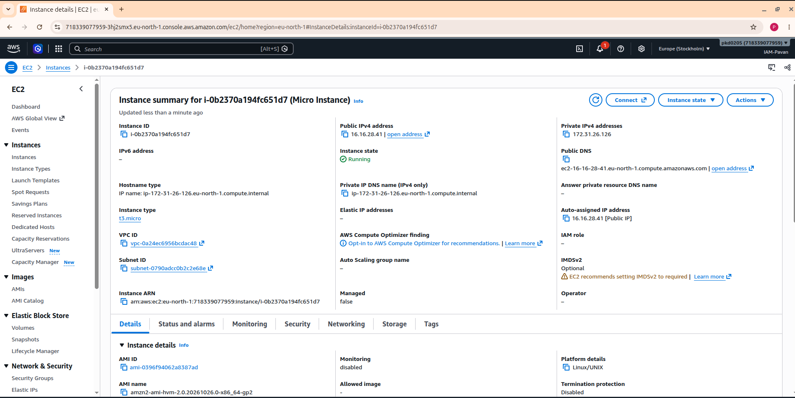

# Create an AWS EC2 Instance Using Terraform Expressions

This guide builds on the variable-based EC2 project and introduces a Terraform **conditional expression** and a **local value**. The EC2 instance uses a tag that is selected automatically according to the configured instance type.

## Project Structure

```text
.
├── main.tf
├── Output.png
├── output.tf
├── terraform.tfstate
├── expression-guide.md
└── variable.tf
```

| File | Purpose |
|---|---|
| `main.tf` | Configures the AWS provider, looks up an Amazon Linux 2 AMI, defines a local value, and declares the EC2 instance. |
| `variable.tf` | Defines the AWS Region, EC2 instance type, and instance name variables used by the project. |
| `output.tf` | Displays the value of the local expression as a Terraform output. |
| `Output.png` | Screenshot of Terraform output. Keep it beside this file to display it below. |
| `terraform.tfstate` | Records Terraform's view of managed resources. Protect it and do not publish it. |
| `expression-guide.md` | This guide, explaining the conditional expression and local value. |

Terraform loads all `.tf` files in the same directory as one configuration. The `main.tf`, `variable.tf`, and `output.tf` files therefore work together.

## Prerequisites

Before starting, make sure you have:

- An AWS account with permission to look up AMIs and create EC2 instances.
- Terraform installed.
- AWS credentials configured for the same operating-system user running Terraform.
- AWS CLI installed (recommended).
- Visual Studio Code or another code editor.

## 1. Understand What Changed

In the previous variable-based project, the EC2 `Name` tag used the `instance_name` variable directly. In this updated version, the project uses a **local value** and a **conditional expression** to choose the tag value based on the EC2 instance type.

The updated logic is:

- If `var.instance_type` equals `t3.micro`, the tag becomes `Micro Instance`.
- Otherwise, the tag becomes `Standard Instance`.

This is an example of making a configuration respond automatically to a selected variable value.

## 2. Configure AWS Credentials

Terraform's AWS provider uses credentials available to the Terraform process; it does not normally sign in through an interactive AWS Console session.

If AWS CLI credentials are already configured for the same Linux user, Terraform can usually reuse them. If needed, configure them with:

```bash
aws configure
```

Enter the requested access key, secret key, default Region (`eu-north-1`), and output format. To check the active identity, run:

```bash
aws sts get-caller-identity
```

Never place AWS access keys in Terraform files or commit them to GitHub.

## 3. Review `variable.tf`

The variable definitions remain the same as in the variable-based project. They should include these variables:

```hcl
variable "aws_region" {
  default = "eu-north-1"
}

variable "instance_type" {
  default = "t3.micro"
}

variable "instance_name" {
  default = "Pavan-Terraform"
}
```

The current expression uses `aws_region` and `instance_type`. The `instance_name` variable may remain defined, but this updated `main.tf` does not use it for the `Name` tag because the tag now comes from `local.name_tag`.

## 4. Update `main.tf`

Replace the contents of `main.tf` with the updated configuration below, then save the file:

```hcl
provider "aws" {
  region = var.aws_region
}

data "aws_ami" "amazon_linux" {
  most_recent = true
  owners      = ["amazon"]

  filter {
    name   = "name"
    values = ["amzn2-ami-hvm-*-x86_64-gp2"]
  }
}

locals {
  name_tag = var.instance_type == "t3.micro" ? "Micro Instance" : "Standard Instance"
}

resource "aws_instance" "my_ec2" {
  ami           = data.aws_ami.amazon_linux.id
  instance_type = var.instance_type

  tags = {
    Name = local.name_tag
  }
}
```

### Explanation of the updated code

**AWS provider**

```hcl
provider "aws" {
  region = var.aws_region
}
```

The provider connects Terraform to AWS. The Region comes from the `aws_region` variable in `variable.tf`.

**AMI data source**

The `aws_ami` data source searches for a matching Amazon Linux 2 AMI owned by Amazon in the configured Region. `most_recent = true` selects the newest matching result. If no matching image is returned, review the filter and confirm an appropriate AMI is available in that Region.

**Local value**

```hcl
locals {
  name_tag = var.instance_type == "t3.micro" ? "Micro Instance" : "Standard Instance"
}
```

The `locals` block defines a named value that can be reused elsewhere in the Terraform configuration. Here, `name_tag` is calculated using a conditional expression.

Terraform conditional expressions follow this pattern:

```hcl
condition ? value_if_true : value_if_false
```

For this project:

- **Condition:** `var.instance_type == "t3.micro"`
- **If true:** `"Micro Instance"`
- **If false:** `"Standard Instance"`

If the instance type is `t3.micro`, Terraform evaluates `local.name_tag` to `Micro Instance`. If the instance type is any other value, it evaluates to `Standard Instance`.

**EC2 resource**

```hcl
resource "aws_instance" "my_ec2" {
  ami           = data.aws_ami.amazon_linux.id
  instance_type = var.instance_type

  tags = {
    Name = local.name_tag
  }
}
```

The EC2 resource uses the AMI ID returned by the data source, reads its instance type from `var.instance_type`, and assigns the computed local value to the `Name` tag.

This configuration does not define an SSH key pair or custom security group. Do not assume SSH access is enabled; network reachability depends on the VPC, subnet, routes, public IP assignment, security groups, and other network settings.

## 5. Update `output.tf`

Replace the contents of `output.tf` with:

```hcl
output "instance_name_tag" {
  value = local.name_tag
}
```

Save the file.

This output displays the calculated value of `local.name_tag`. With the default `t3.micro` instance type, the output should be:

```text
instance_name_tag = "Micro Instance"
```

The output reports the selected tag value; it is not the EC2 instance's public IP address.

## 6. Open the Project in VS Code

If the project directory already exists, open a terminal in that directory and run:

```bash
code .
```

Confirm that `main.tf`, `variable.tf`, and `output.tf` contain the expected code and save all changes.

## 7. Initialize Terraform

Run the following command from the project directory:

```bash
terraform init
```

Terraform initializes the working directory and downloads the required provider plugin. If the project was initialized earlier, this command checks and prepares the working directory again as needed.

## 8. Format and Validate the Configuration

Run:

```bash
terraform fmt
terraform validate
```

- `terraform fmt` formats the Terraform files consistently.
- `terraform validate` checks the configuration's syntax and internal consistency.

These checks do not guarantee that AWS credentials, permissions, or the AMI lookup will succeed.

## 9. Review the Execution Plan

```bash
terraform plan
```

Read the proposed changes before proceeding. Terraform may propose creating an EC2 instance if it is not already tracked in the current state. If an instance already exists, the plan may instead show no changes or propose an update. Always rely on the plan shown for your environment.

## 10. Apply the Configuration

```bash
terraform apply
```

Review the plan. Type `yes` and press **Enter** only if you approve the proposed changes.

After a successful apply, Terraform should display the `instance_name_tag` output. With the default `t3.micro` instance type, it should show `Micro Instance`.

## 11. Test the Conditional Expression

You can preview the behavior with a different instance type using a variable override.

For example, plan with `t3.small`:

```bash
terraform plan -var="instance_type=t3.small"
```

Because `t3.small` does not equal `t3.micro`, the expression evaluates to `Standard Instance`. Check the plan and output behavior before applying any changes.

To apply that alternative value:

```bash
terraform apply -var="instance_type=t3.small"
```

Review the plan and confirm only if the changes are intended. Changing the instance type can affect cost and may cause Terraform to modify or replace the EC2 instance depending on the change and provider behavior. Check the plan carefully.

To return to the default instance type, run Terraform without the override after confirming that the default in `variable.tf` is still `t3.micro`:

```bash
terraform plan
terraform apply
```

Review and approve the plan when appropriate.

## 12. Verify the Output in AWS and Terraform

To see the declared output again, run:

```bash
terraform output
```

To show only the expression result, run:

```bash
terraform output instance_name_tag
```

To verify the EC2 instance, open the [AWS Management Console](https://console.aws.amazon.com/), select **EC2**, choose the **Europe (Stockholm) — `eu-north-1`** Region, and inspect the instance's `Name` tag.

### Output screenshot

Keep `Output.png` in the same directory as this Markdown file if you want the screenshot to display below.



## 13. Protect Terraform State

Terraform uses `terraform.tfstate` to track resources it manages. State can contain sensitive infrastructure details, so:

- Do not publish the state file in a public repository.
- Exclude local state files from Git.
- Restrict access to state data.
- For team or production use, consider a secure remote backend with access controls and encryption.
- Avoid manually editing the state file.

A basic `.gitignore` can include:

```gitignore
.terraform/
*.tfstate
*.tfstate.*
*.tfplan
crash.log
crash.*.log
```

The `.terraform.lock.hcl` file, if generated, is generally useful to keep under version control.

## 14. Troubleshooting

| Problem | What to check |
|---|---|
| `terraform: command not found` | Install Terraform and reopen the terminal. |
| AWS credential or access-denied error | Run `aws sts get-caller-identity` and check IAM permissions. |
| No matching AMI found | Review the AMI name filter and confirm a matching image exists in `eu-north-1`. |
| Output shows `Standard Instance` | Check whether `instance_type` is set to a value other than `t3.micro`. |
| Output value does not reflect a recent change | Review the variable value and plan, then apply the intended changes. |
| Instance is not visible in the console | Confirm the console Region is `eu-north-1`. |
| Terraform proposes unexpected changes | Read the full plan and verify the configuration and state before approving. |

## 15. Cost and Cleanup

AWS may charge for EC2 compute, storage, data transfer, and related resources. Costs depend on the Region, instance type, configuration, account eligibility, and current AWS pricing. Review current pricing and monitor billing.

When you no longer need the resources managed by this project, run:

```bash
terraform destroy
```

Review the proposed deletions and type `yes` only if you intend to remove them. Do not run this command if you want to keep the instance.

## Summary

This project adds a Terraform conditional expression and local value to a variable-based EC2 configuration. The expression checks the selected instance type and chooses a corresponding `Name` tag: `Micro Instance` for `t3.micro`, or `Standard Instance` for other instance types. The `output.tf` file displays the calculated tag value.

## Official References

- [Terraform Documentation](https://developer.hashicorp.com/terraform/docs)
- [Terraform Conditional Expressions](https://developer.hashicorp.com/terraform/language/expressions/conditionals)
- [Terraform Local Values](https://developer.hashicorp.com/terraform/language/values/locals)
- [Terraform Input Variables](https://developer.hashicorp.com/terraform/language/values/variables)
- [AWS Provider Documentation](https://registry.terraform.io/providers/hashicorp/aws/latest/docs)
- [Amazon EC2 Documentation](https://docs.aws.amazon.com/ec2/)
